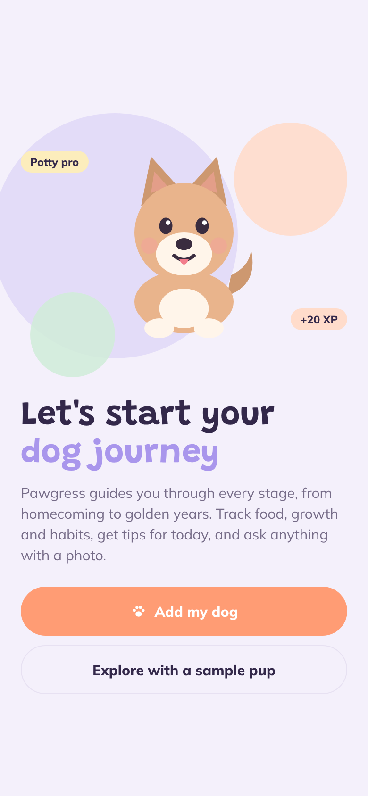
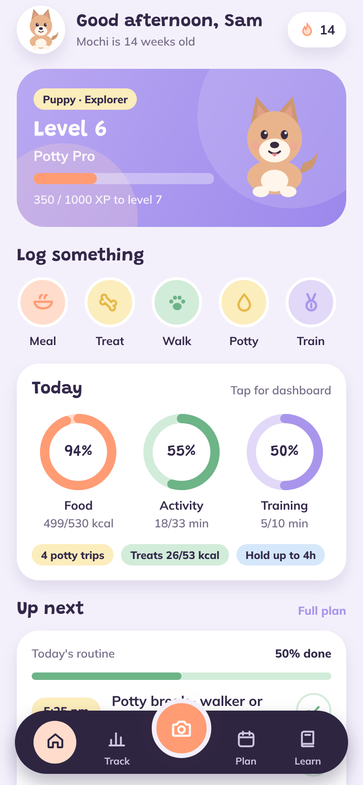
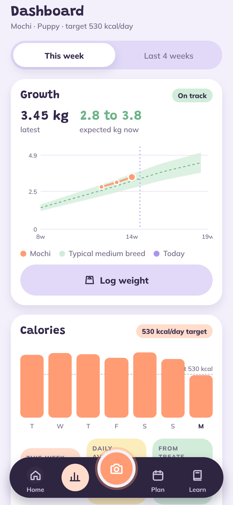
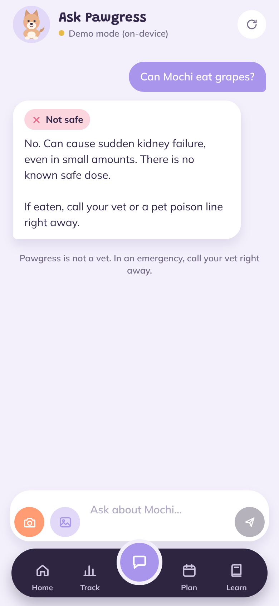
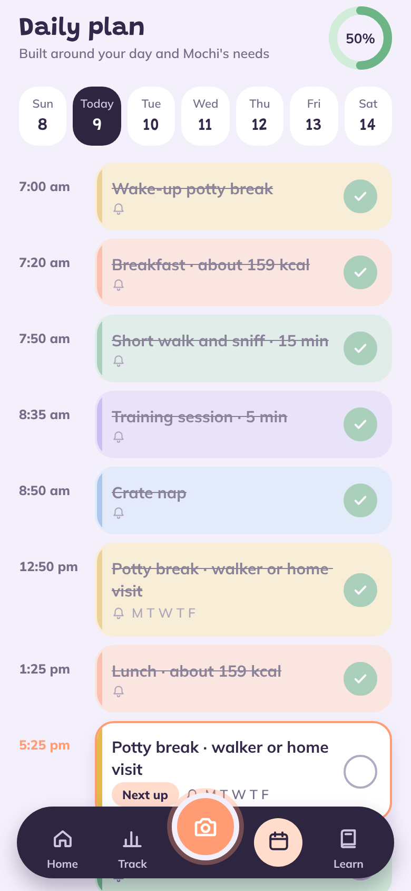
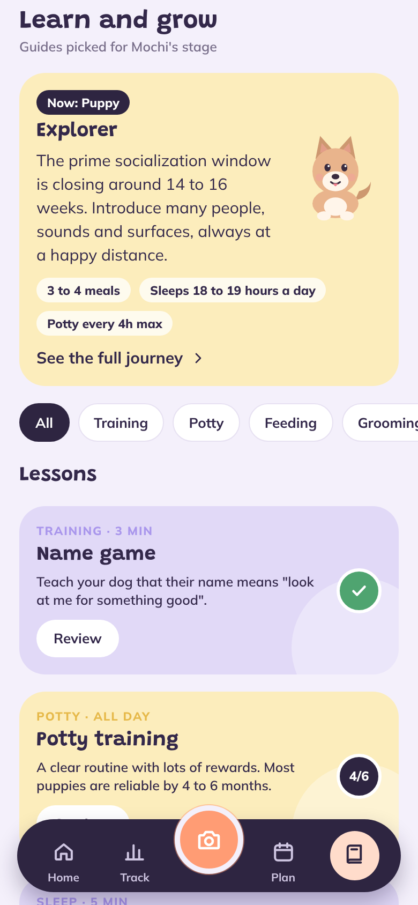
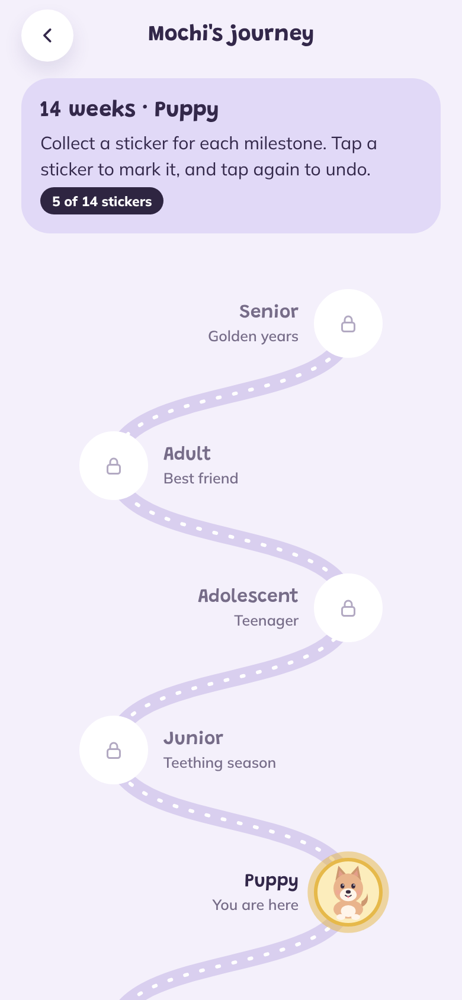
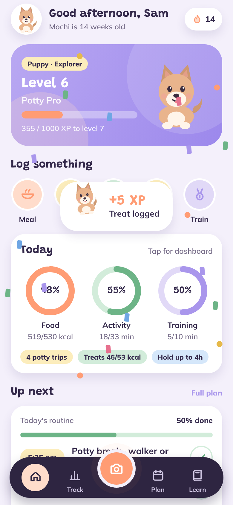

# Pawgress

A playful companion app for dog owners, especially new ones. Pawgress tracks your dog's growth, food, exercise, potty and grooming, plans your day around both of you, teaches you what to do at each life stage, and answers questions in a chat where you can snap a photo, like "can my dog eat this?".

Built with Expo (React Native) for iOS and Android. Everything is stored on the phone.

| Welcome | Home | Dashboard | Ask |
| --- | --- | --- | --- |
|  |  |  |  |

| Plan | Learn | Journey | Reward |
| --- | --- | --- | --- |
|  |  |  |  |

## What it does

**1. Ask with photos.** A chat tab with camera and photo buttons. Ask "can she eat this?" with a picture, or ask about potty timing, portions, biting and more. Food answers get a clear Safe, Feed with care or Not safe tag, and warnings when a food matches your dog's allergies. The AI is pluggable (see [AI chat](#ai-chat)).

**2. Profile and trackers.** Name, photo (or a cartoon in your dog's coat color), breed, birthday, weight, neutered status, energy level and allergies. Log meals, treats, walks, play, training, potty (with accidents and stool check), grooming, sleep, health symptoms and weigh-ins in a couple of taps.

- **Calories for this stage.** The daily, weekly and monthly targets use resting energy (70 × kg^0.75) times a life-stage factor (×3 under 4 months, ×2 while growing, ×1.6 or ×1.8 for adults, ×1.4 for seniors), adjusted for energy level. Targets update as your dog ages and gains weight. Treats get a 10% budget.
- **Food library.** Each food records how much your dog likes it (loves to refuses), its treat value (high, medium or low), and reactions (upset tummy or allergy). Logging a meal keeps this up to date, and the dashboard lists favorites, high-value treats, refusals and reactions.

**3. Tips for every stage and task.** Six life stages (baby puppy, puppy, junior, adolescent, adult, senior), sized to your breed, since large breeds grow up later. Each stage has a summary and focus areas, plus:

- potty guidance: how long they can hold it, and how often to expect pee and poo
- feeding, training, grooming (by coat type), socialization, health, exercise and sleep tips
- 12 step-by-step lessons with progress, such as sit, come, crate training, potty training, tooth brushing and alone time

**4. A daily plan that fits your schedule.** Onboarding asks when you wake, work and sleep. Pawgress then builds a routine of meals, walks, training, naps, grooming and potty breaks. Potty breaks are never further apart than your dog can hold it, and it flags the ones you'll need a walker for while you're at work. You can edit, add or delete tasks, choose their days, and rebuild the plan when your hours change. Reminders arrive 10 minutes before each task.

**5. Dashboard.** Shows a growth curve against the expected band for your dog's size, calories against target (week or 4 weeks), exercise, potty success rate, a time-of-day chart showing when your dog usually goes, grooming due dates, food insights and a full history.

**6. Extras for new owners.**

- Checklists: homecoming kit, puppy-proofing, vet and paperwork, and socialization bingo.
- A life-stage journey map with 14 milestone stickers.
- XP, levels, streaks and confetti, so daily care feels like a game.
- Backup export and restore.

## Run it

You need Node 20+ and the **Expo Go** app on your phone (App Store or Google Play).

```bash
npm install
npx expo start
```

Scan the QR code with your phone camera (iPhone) or the Expo Go app (Android). To look around before entering your own dog, tap **Explore with a sample pup** on the welcome screen. It loads Mochi, a 14-week-old Shiba Inu with two weeks of example logs.

Other commands:

```bash
npx expo start --web   # run in a browser (camera and reminders are limited there)
npx tsc --noEmit       # typecheck
npx expo lint          # lint
```

**Reminders:** local reminders work in Expo Go on most phones. If they don't fire on yours, build a development build (`npx expo run:ios` / `npx expo run:android`, or `eas build --profile development`).

## AI chat

The chat works in two modes:

- **Demo mode (default).** No key is needed and nothing leaves the phone. It answers from Pawgress's built-in knowledge: about 35 common foods (safe, caution or toxic), calorie targets, potty timing, exercise, grooming, training and when to call the vet, all tailored to your dog. It cannot look at photos, and it says so.
- **Claude through your own server.** For real photo understanding and open-ended questions, run the small proxy in [`server/`](server). It keeps your API key on your computer instead of inside the app.

```bash
cd server
npm install
ANTHROPIC_API_KEY=sk-ant-... npm start      # listens on port 8787
```

Then in the app, open **Profile → AI connection**, enter `http://<your-computer's-local-IP>:8787` and tap **Save and test**. Your phone and computer must be on the same Wi-Fi. To stop others on your network from using it, set `APP_TOKEN=some-code` on the server and enter the same access code in the app. You can also bake the address into a build with `EXPO_PUBLIC_AI_PROXY_URL`.

The server uses `claude-opus-5-5` by default (override with `PAWGRESS_MODEL`). It shrinks photos to 1024 px before upload, tells the model your dog's profile, and asks it to lead food answers with a safety verdict.

## Project layout

```
src/
  app/                 screens (Expo Router)
    (tabs)/            Home, Track (dashboard), Ask (chat), Plan, Learn
    onboarding.tsx     add-your-dog flow
    log/[type].tsx     logging sheet for every tracker
    lesson/[id].tsx    step-by-step lessons
    checklist/[id].tsx new-owner checklists
    journey.tsx        life-stage map and milestone stickers
    foods.tsx          food library
    profile.tsx        dog profile, AI connection, backup
  components/          UI kit, animated mascot, charts, tab bar, celebrations
  data/                breeds, life stages, food safety, tips, lessons, checklists
  lib/                 state store, calorie and growth math, routine builder, reminders, AI
server/                Claude proxy for the chat
```

## A note on accuracy

Targets and tips follow widely published veterinary guidance and breed averages. They are estimates for typical dogs, not a diagnosis. Pawgress reminds owners to check with their vet, and points them to emergency care for red-flag symptoms.
